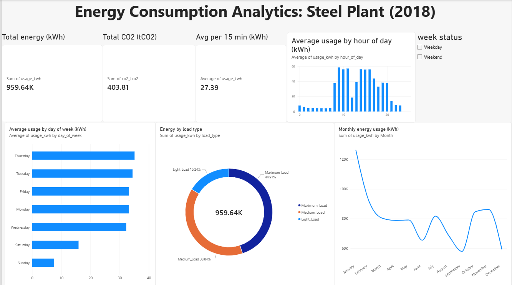

# Energy Consumption Analytics: Steel Plant (2018)

## Overview
Analysis of one year of 15-minute electricity readings from a steel plant, to find when energy is used, which operating conditions drive most of the energy and CO2, and where savings could come from.

## Dataset
Steel Industry Energy Consumption, UCI Machine Learning Repository (CC BY 4.0): https://archive.ics.uci.edu/dataset/851/steel+industry+energy+consumption

35,040 rows covering 1 Jan to 31 Dec 2018. `energy_project.csv` is the cleaned export used in Power BI.

## Tools
- MySQL: data preparation and analysis
- Power BI: dashboard (including one DAX calculated column for hour of day)

## Process
1. Loaded the CSV into MySQL and converted the day/month/year text dates to DATETIME with STR_TO_DATE (0 failed conversions).
2. Wrote eight SQL queries: overall totals, day of week, weekday vs weekend, load type with share of energy (window function), monthly totals, hourly pattern, top 10 days, and month-over-month change (CTE and LAG).
3. Exported the prepared table and built a one-page Power BI dashboard with three KPI cards, four charts and a Weekday/Weekend slicer.

## Key findings
1. **Weekdays use about 2.9 times more energy than weekends.** The average is 33.6 kWh on weekdays and 11.7 kWh on weekends, and weekdays account for about 88% of total energy.
2. **Maximum load is the main driver.** It is about 21% of readings but about 45% of the energy and about 48% of the CO2.
3. **Usage follows the working day.** About 4 kWh from 2am to 7am, a jump at 8am, a peak around 9am (about 58 kWh), a dip around noon, then a fall after 8pm.
4. **Usage varies across the year.** January is highest (about 126K kWh) and September lowest (about 58K kWh).

## Possible recommendations
These are ideas to test, not proven savings:
- Shift flexible loads away from the morning peak.
- Reduce time spent at maximum load where possible.
- Investigate what drove the January peak.

## Files
- `energy_project.sql` and `energy_project2.sql`: SQL scripts (table setup and date conversion, and the eight analysis queries)
- `energy_dashboard.pbix`: Power BI dashboard file
- `dashboard.png`: dashboard screenshot
- `energy_project.csv`: cleaned data export

## Limitations
One plant, one year, no weather or production data, so the findings describe patterns, not causes.
